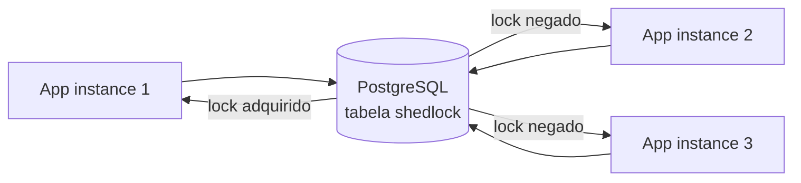
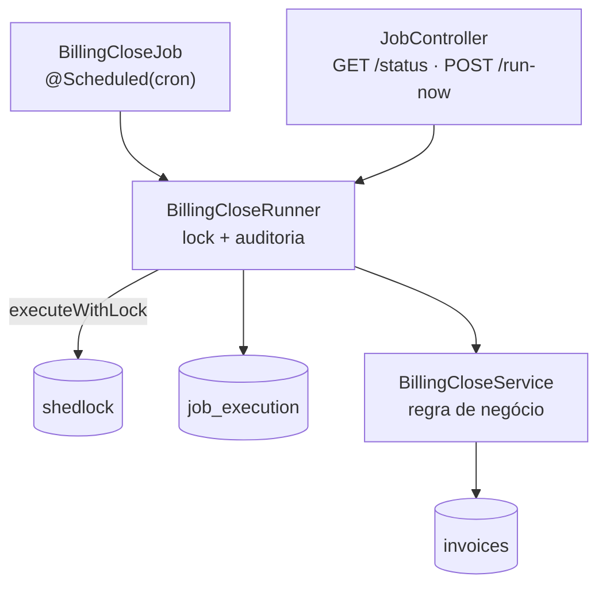

# distributed-job-lock

Job agendado em Spring Boot 3.5 (Java 21) que roda **exatamente uma vez por janela**, mesmo com três instâncias da aplicação no ar — usando ShedLock sobre PostgreSQL.

## Problema

Três instâncias da mesma aplicação sobem atrás de um load balancer. Todas carregam o mesmo `@Scheduled`. Sem coordenação, o fechamento de faturas roda três vezes no mesmo segundo: cobrança triplicada, e-mail triplicado, relatório triplicado.

Uma maravilha, se o objetivo for emitir boleto em triplicata e chamar isso de feature.

O que este projeto entrega:

- uma única instância executa o job por janela;
- as outras registram por que não executaram;
- se a instância vencedora morrer no meio, o lock expira e o job volta a rodar;
- o resultado da última execução é consultável por HTTP.

## Stack

- Java 21
- Spring Boot 3.5.16
- Spring Scheduler (`@Scheduled`)
- ShedLock 7.9.0 (`shedlock-spring` + `shedlock-provider-jdbc-template`)
- PostgreSQL 16 + Flyway
- Spring `JdbcClient`
- Testcontainers, JUnit 5, AssertJ, MockMvc
- Docker Compose

## Escolha da ferramenta

| Opção | + | − |
| --- | --- | --- |
| **ShedLock + PostgreSQL** (usada aqui) | Feito exatamente para `@Scheduled`; lock visível e auditável numa tabela; custo operacional zero | Não é um scheduler: não faz retry, misfire nem trigger complexo |
| Quartz clustered | Scheduler completo, triggers ricos, tratamento de misfire | Muita configuração e tabelas para um microprojeto |
| Advisory lock manual do PostgreSQL | Zero dependência extra, controle total | Fácil errar timeout, release e observabilidade |

## A decisão que dá forma ao projeto: ShedLock programático

O caminho idiomático seria anotar o método agendado com `@SchedulerLock`. Ele **não serve aqui**: quando o lock não é adquirido, o ShedLock simplesmente não chama o método. O skip é invisível para a aplicação — e um dos requisitos é justamente registrar `SKIPPED_LOCK_NOT_ACQUIRED`.

Por isso o job usa a API programática, onde `wasExecuted()` é o sinal que transforma "não fiz nada" em auditoria:

```java
TaskResult<Integer> result = lockingTaskExecutor.executeWithLock(
        (TaskWithResult<Integer>) () -> billingCloseService.closePendingInvoices(instanceId),
        lock);

execution = result.wasExecuted()
        ? finished(JobStatus.SUCCESS, result.getResult(), source, startedAt, null)
        : finished(JobStatus.SKIPPED_LOCK_NOT_ACQUIRED, 0, source, startedAt, null);
```

## Arquitetura



Dentro de cada instância, cada classe tem uma responsabilidade só:



- **`BillingCloseJob`** — só o agendamento.
- **`BillingCloseRunner`** — tenta o lock, mede a execução, grava o registro. Único ponto do sistema que conhece o ShedLock; não sabe o que é uma fatura.
- **`BillingCloseService`** — fecha faturas pendentes. Não sabe o que é um lock.
- **`JobController`** — status e disparo manual.

## Modelo de dados

Três tabelas, todas criadas por Flyway (`src/main/resources/db/migration`):

| Tabela | Papel |
| --- | --- |
| `shedlock` | O lock em si. Uma linha por job: enquanto `lock_until` estiver no futuro, ninguém mais executa. |
| `invoices` | O trabalho a fazer (`PENDING` → `CLOSED`, com `closed_by` e `closed_at`). |
| `job_execution` | Auditoria: **uma linha por tentativa**, inclusive as que não conseguiram o lock. É isso que torna o skip visível. |

O seed de demonstração (42 faturas pendentes) fica em `db/seed` e só é aplicado no profile `docker` — os testes montam os próprios dados.

## Como rodar

### Uma instância

```bash
docker compose up -d db
JAVA_HOME=/caminho/do/jdk-21 ./mvnw spring-boot:run
```

### Três instâncias

```bash
docker compose up --build --scale app=3
```

Não há porta fixa no host (um mapeamento `8080:8080` quebraria o `--scale`). Para descobrir a porta de uma réplica:

```bash
docker compose port --index 1 app 8080
# 0.0.0.0:57550
```

## Endpoints

### `GET /jobs/billing-close/status`

Última execução registrada, qualquer que seja o status:

```json
{"job":"billing-close","lastRunAt":"2026-08-20T15:38:00.008732Z","lastOwner":"eb9934c98a12","lastStatus":"SKIPPED_LOCK_NOT_ACQUIRED","processedItems":0}
```

Sem nenhuma execução ainda, os campos vêm ausentes e `processedItems` é `0`, com HTTP 200.

### `POST /jobs/billing-close/run-now`

Dispara o job pelo mesmo caminho do agendamento (`triggerSource=MANUAL`) e, portanto, **também respeita o lock**:

```bash
$ curl -sX POST http://localhost:57550/jobs/billing-close/run-now
{"job":"billing-close","lastRunAt":"2026-08-20T15:38:28.014428204Z","lastOwner":"a39ca0998d26","lastStatus":"SUCCESS","processedItems":5}

# imediatamente depois, com lockAtLeastFor=PT10S ainda segurando:
$ curl -sX POST http://localhost:57550/jobs/billing-close/run-now
{"job":"billing-close","lastRunAt":"2026-08-20T15:38:28.086768955Z","lastOwner":"a39ca0998d26","lastStatus":"SKIPPED_LOCK_NOT_ACQUIRED","processedItems":0}
```

A resposta é 200 mesmo no skip: lock negado é informação, não erro.

## Demonstração com três instâncias

Logs reais de `docker compose up --build --scale app=3` (o `instanceId` é o hostname do container):

```text
app-1  | 15:36:00.200  INFO [a39ca0998d26] BillingCloseRunner : [a39ca0998d26] job=billing-close status=SKIPPED_LOCK_NOT_ACQUIRED processed=0 trigger=SCHEDULED
app-2  | 15:36:00.203  INFO [eb9934c98a12] BillingCloseRunner : [eb9934c98a12] job=billing-close status=SKIPPED_LOCK_NOT_ACQUIRED processed=0 trigger=SCHEDULED
app-3  | 15:36:00.358  INFO [a7fd6f869b71] BillingCloseRunner : [a7fd6f869b71] job=billing-close status=SUCCESS processed=42 trigger=SCHEDULED
app-1  | 15:37:00.022  INFO [a39ca0998d26] BillingCloseRunner : [a39ca0998d26] job=billing-close status=SKIPPED_LOCK_NOT_ACQUIRED processed=0 trigger=SCHEDULED
app-3  | 15:37:00.027  INFO [a7fd6f869b71] BillingCloseRunner : [a7fd6f869b71] job=billing-close status=SKIPPED_LOCK_NOT_ACQUIRED processed=0 trigger=SCHEDULED
app-2  | 15:37:00.066  INFO [eb9934c98a12] BillingCloseRunner : [eb9934c98a12] job=billing-close status=SUCCESS processed=0 trigger=SCHEDULED
```

Duas coisas aparecem aí:

1. Por minuto, exatamente **um** `SUCCESS` e **dois** `SKIPPED_LOCK_NOT_ACQUIRED` — e o vencedor muda entre as janelas (app-3, depois app-2). Não existe instância "principal".
2. A primeira rodada fechou 42 faturas; a segunda, 0. O trabalho não foi refeito.

A mesma história na tabela de auditoria:

```text
    owner     |          status           | processed_items | trigger_source
--------------+---------------------------+-----------------+----------------
 a7fd6f869b71 | SUCCESS                   |               0 | SCHEDULED
 a39ca0998d26 | SKIPPED_LOCK_NOT_ACQUIRED |               0 | SCHEDULED
 eb9934c98a12 | SKIPPED_LOCK_NOT_ACQUIRED |               0 | SCHEDULED
 eb9934c98a12 | SUCCESS                   |               0 | SCHEDULED
 a7fd6f869b71 | SKIPPED_LOCK_NOT_ACQUIRED |               0 | SCHEDULED
 a39ca0998d26 | SKIPPED_LOCK_NOT_ACQUIRED |               0 | SCHEDULED
 a7fd6f869b71 | SUCCESS                   |              42 | SCHEDULED
```

## `lockAtMostFor` e `lockAtLeastFor`

```yaml
job:
  billing-close:
    cron: "0 * * * * *"      # todo minuto cheio
    lock-at-most-for: PT2M   # teto: se a instância morrer, o lock cai em 2 min
    lock-at-least-for: PT10S # piso: segura o lock mesmo se o job for instantâneo
```

- **`lockAtMostFor`** é a rede de segurança para instância que morre sem liberar o lock. Precisa ser **maior que a pior duração esperada do job** e menor que a janela em que a duplicação passa a doer. Curto demais: duas instâncias se sobrepõem. Longo demais: um crash trava o job por tempo demais.
- **`lockAtLeastFor`** protege contra relógios levemente dessincronizados. Sem ele, um job que termina em 20 ms libera o lock a tempo de outra instância pegar o mesmo tique e executar de novo.

O provider é configurado com `usingDbTime()`: o relógio de referência passa a ser o do PostgreSQL, e não o de cada container. Um detalhe que vem junto — o ShedLock grava a coluna em **UTC** (`timezone('utc', CURRENT_TIMESTAMP)`), o que importa na hora de mexer na tabela à mão.

## Instância morta

Não existe release explícito no crash: o lock simplesmente vence. Para simular:

```bash
docker compose exec db psql -U joblock -d joblock -c \
  "UPDATE shedlock SET locked_by='instancia-morta',
      locked_at  = timezone('utc', now()) - interval '10 minutes',
      lock_until = timezone('utc', now()) - interval '5 minutes'
   WHERE name='billing-close';"

curl -sX POST http://localhost:57550/jobs/billing-close/run-now
# {"job":"billing-close","lastRunAt":"2026-08-20T15:38:28.615516716Z","lastOwner":"a39ca0998d26","lastStatus":"SUCCESS","processedItems":0}
```

A próxima instância assume o lock. `lockAtMostFor` é o tempo máximo que esse buraco pode durar.

## Idempotência: duas camadas

O lock **coordena**; quem **garante a correção** é o banco:

```sql
UPDATE invoices
SET status = 'CLOSED', closed_at = now(), closed_by = :closedBy
WHERE id = :id AND status = 'PENDING'
```

Só linhas realmente afetadas entram na contagem. Isso importa porque o lock pode falhar: se o job demorar mais que `lockAtMostFor`, duas instâncias se sobrepõem — e nesse caso a fatura ainda assim não é fechada duas vezes.

Tratar lock distribuído como garantia absoluta é o erro clássico. Ele é otimização de coordenação.

## Testes

```bash
JAVA_HOME=/caminho/do/jdk-21 ./mvnw test
```

15 testes, todos contra um PostgreSQL real via Testcontainers (um único container para a suíte):

| Cenário | Onde |
| --- | --- |
| Cria registro de lock na tabela `shedlock` | `BillingCloseRunnerTest` |
| Impede execução simultânea (3 threads, 1 vence) | `BillingCloseLockContentionTest` |
| Grava uma linha de auditoria por tentativa | `BillingCloseLockContentionTest` |
| Libera o lock após o timeout (instância morta) | `BillingCloseRunnerTest` |
| Não executa enquanto outra instância segura o lock | `BillingCloseRunnerTest` |
| Registra o owner e o trigger da execução | `BillingCloseRunnerTest` |
| Idempotência no processamento das faturas | `BillingCloseServiceTest` |
| Status e `run-now` via HTTP | `JobControllerTest` |
| Migrations aplicadas, seed fora do profile `docker` | `SchemaMigrationTest` |

Duas armadilhas que o `ShedLockFixture` (em `src/test/java/.../support`) documenta e evita:

1. **Timezone** — o ShedLock grava `shedlock` em UTC. Um fixture com `now()` puro, numa sessão em UTC-3, cria um "futuro" três horas no passado — e o teste passa a afirmar o contrário do que pretendia.
2. **`LockRecordRegistry`** — o ShedLock guarda em memória quais locks já tiveram linha inserida e, a partir daí, só faz `UPDATE`. Apagar a linha por fora deixa o provider num estado impossível em produção, onde a linha nunca é removida: um lock liberado é apenas uma linha com `lock_until` no passado.

## Critérios de aceite

- [x] Com 1 instância, o job executa normalmente.
- [x] Com 3 instâncias, apenas uma executa.
- [x] As outras registram `SKIPPED_LOCK_NOT_ACQUIRED`.
- [x] Se a instância morrer, o lock expira.
- [x] Tabela `shedlock` criada via Flyway.
- [x] `lockAtMostFor` e `lockAtLeastFor` configuráveis.
- [x] `instanceId` em todo log do job.
- [x] `docker compose up --scale app=3` documentado e verificado.
